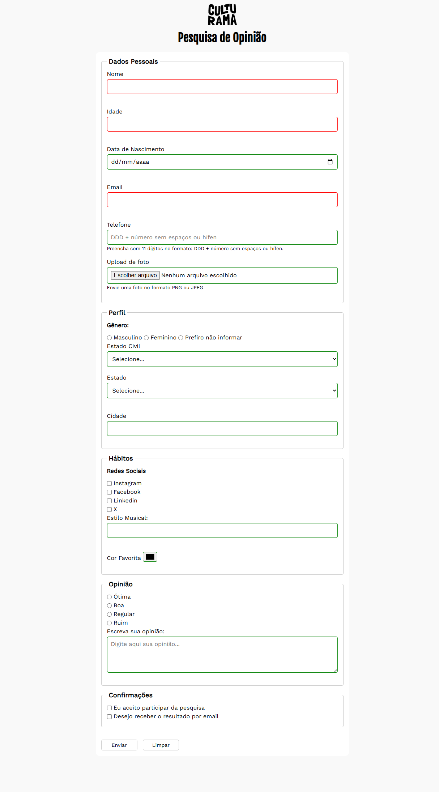

# Pesquisa Culturama

-9cf?style=for-the-badge)


> **🎓 Projeto guiado:** desenvolvido acompanhando as aulas da formação de **Front-end da [Alura](https://www.alura.com.br/)**. O layout e a proposta são do curso; a implementação foi feita por mim, seguindo o professor.

Formulário de pesquisa de opinião construído com HTML5 e CSS3, explorando os principais elementos de formulário, validação nativa do navegador, semântica, acessibilidade e responsividade.

🔗 **[Ver projeto online](https://lpwesley.github.io/pesquisa-culturama/)**

## 📸 Prévia



## 🛠️ Tecnologias

- **HTML5:** estrutura semântica e formulários
- **CSS3:** estilização e layout responsivo
- **Git e GitHub:** versionamento e publicação

## ⚙️ Funcionalidades

- Campos de dados pessoais, e-mail, telefone e data
- Alternativas com `radio` e `checkbox`, listas com `select`
- Upload de arquivo e campo de comentários
- Validação nativa com `required`, `pattern`, `min` e `max`
- Campos agrupados com `fieldset` e `legend`, rótulos ligados com `label` e `for`
- Página de confirmação após o envio
- Layout adaptado a diferentes tamanhos de tela

> O formulário não envia dados para um servidor: o foco do projeto é a construção e a validação no front-end.

## 📚 O que pratiquei

**HTML e formulários**
- Diferentes tipos de `input` e quando usar cada um
- Organização e acessibilidade de formulários com `fieldset`, `legend` e `label`
- Validação nativa do navegador

**CSS e responsividade**
- Estilização dos elementos de formulário
- Espaçamentos, alinhamentos e organização dos arquivos CSS
- Adaptação do layout para diferentes resoluções

**Acessibilidade e boas práticas**
- Uso de elementos semânticos e identificação clara dos campos
- Atributos ARIA onde necessário
- Código organizado e versionado com Git

## 📂 Estrutura

```text
pesquisa-culturama/
├── css/
├── img/
│   ├── logo-culturama.png
│   └── preview.png
├── nav/
├── culturama-favico.png
├── index.html
└── README.md
```

## 💻 Como executar

Não há dependências. Basta clonar e abrir no navegador:

```bash
git clone https://github.com/lpwesley/pesquisa-culturama.git
cd pesquisa-culturama
```

Abra o `index.html` no navegador ou use a extensão **Live Server** no VS Code.

## 🎓 Créditos

Projeto proposto pela **[Alura](https://www.alura.com.br/)** como parte da formação em Front-end. O design e o conteúdo base pertencem ao curso.

---

Desenvolvido por **Wesley Lauwer** · [GitHub](https://github.com/lpwesley)
